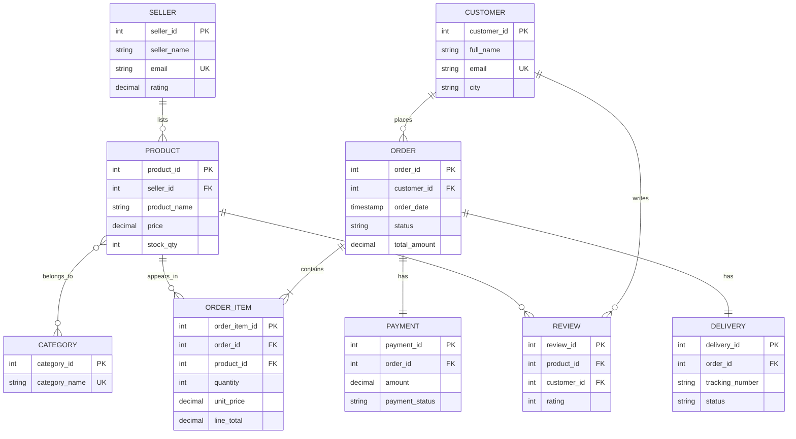

# Entity-Relationship Diagram Description
**ShopEase Online Marketplace**  
**Student:** Aisha Ali Bukar | ID: 301912009

## Textual Description of Relationships

| Entity A     | Cardinality | Entity B        | Relationship Description                     |
|--------------|-------------|-----------------|----------------------------------------------|
| SELLER       | 1 : M       | PRODUCT         | A seller lists many products                 |
| CUSTOMER     | 1 : M       | ORDER           | A customer places many orders                |
| ORDER        | 1 : M       | ORDER_ITEM      | An order contains many line items            |
| PRODUCT      | 1 : M       | ORDER_ITEM      | A product can appear in many order items     |
| ORDER        | 1 : 1       | PAYMENT         | Each order has one payment record            |
| ORDER        | 1 : 1       | DELIVERY        | Each order has one delivery record           |
| PRODUCT      | M : M       | CATEGORY        | Products belong to multiple categories       |
| CUSTOMER     | 1 : M       | REVIEW          | A customer can write many reviews            |
| PRODUCT      | 1 : M       | REVIEW          | A product can receive many reviews           |

## Mermaid ER Diagram Code
Copy the code below into any Mermaid live editor (mermaid.live) or VS Code Mermaid extension to generate the visual diagram. Export as PNG/SVG for submission.

## How to produce the final diagram image
1. Go to https://mermaid.live
2. Paste the Mermaid code above
3. Export as PNG or SVG
4. Save the image as `ER_Diagram_ShopEase.png` inside this folder
5. Reference the image in your LMS documentation and GitHub README
